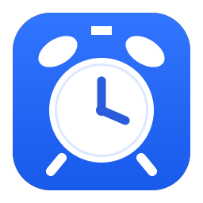
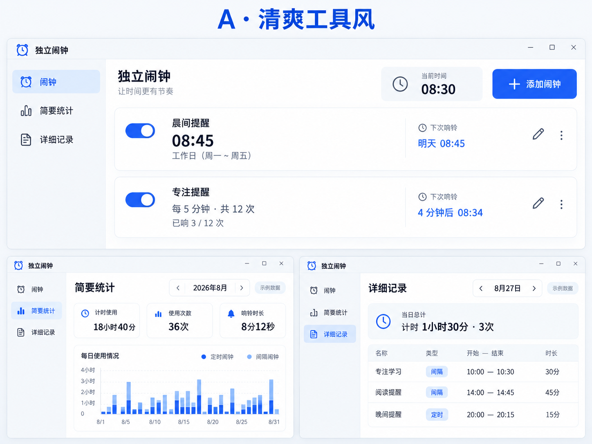

<!-- alarmapp-download-repository -->

# Alarm-app · 实时闹钟

一个独立运行的 Windows 桌面闹钟，支持定时提醒、有限次数的间隔提醒和使用记录查询。使用者不需要 Codex、账号或编译工具。

[下载与版本发布](https://github.com/lmynb68/Alarm-app/releases) · [问题反馈](https://github.com/lmynb68/Alarm-app/issues) · [Visual Studio 上传说明](docs/VISUAL_STUDIO.md)

> 首个 GitHub Release 尚未发布。仓库源码和发行包是两个不同入口：普通用户下载 Release 中的 ZIP；开发者打开解决方案。

## 功能

- 定时闹钟：单次或按星期重复，支持读取当前时间，精确到秒。
- 间隔提醒：自定义间隔和次数，例如每 5 分钟响一次，共 12 次。
- 响铃操作：停止、5 分钟后提醒；关闭主窗口后留在托盘运行。
- 铃声：5 种内置声音，每个闹钟独立选择，支持导入 WAV / MP3 和试听。
- 界面语言：简体中文 / English，切换后记住选择。
- 简要统计：按月、按类型查看计时使用时长、使用次数和响铃时长。
- 详细记录：按天查看名称、闹钟类型、开始结束时间和持续时长。

## 下载安装

需要 Windows 10 / 11 桌面环境及 .NET Framework 4.8 或更高版本。

| 下载文件 | 使用方式 |
| --- | --- |
| AlarmApp-1.0.0-Portable.zip | 完整解压，然后双击 AlarmApp.exe；保留声音和图标资源。 |
| AlarmApp-1.0.0-Setup.zip | 完整解压，然后双击 Install.cmd；按当前用户安装并创建快捷方式。 |
| SHA256SUMS.txt | 用于检查两个下载包的 SHA-256。 |

安装包为脚本安装 ZIP，包含快捷方式和卸载支持。安装位置为 %LOCALAPPDATA%/Programs/AlarmApp，可从 Windows 应用列表或开始菜单卸载。程序不会自动设置开机启动。

更新或卸载前，从托盘退出已运行的闹钟。关机、注销和退出程序后不会响铃；睡眠唤醒取决于硬件与 Windows 电源设置。当前发行包未进行代码签名。

## 数据与统计口径

设置、导入的铃声和历史记录保存在 %LOCALAPPDATA%/IndependentAlarm，发行包不包含维护者的个人记录，卸载时保留用户数据。

计时使用时长是闹钟启用且程序运行的时间；多个闹钟分别累计。使用次数是查询期间有计时时长的启用会话数。响铃时长是响铃窗口打开至停止或稍后提醒的时间。跨日、跨月按日期分摊；测试响铃不计入历史。历史从启用记录功能开始积累，不补造旧记录。

## 用 Visual Studio 开发

1. 克隆 https://github.com/lmynb68/Alarm-app.git，或打开本地 AlarmApp.sln。
2. 安装 .NET 桌面开发工作负载和 .NET Framework 4.8 targeting pack。
3. 选择 Release / Any CPU，生成解决方案，再运行项目。

也可在 Windows 双击 Build.cmd：编译、运行自检并生成 artifacts/ 下的便携包、安装包和校验文件。自检失败时不会生成新的发行压缩包。安装与卸载仍需要按 [验收清单](docs/TESTING.md) 手动验证。

## 项目结构

| 路径 | 内容 |
| --- | --- |
| src/AlarmApp/ | C# 源码、项目文件和版本信息 |
| assets/ | 多尺寸图标与内置铃声 |
| installer/ | 当前用户安装及卸载脚本 |
| tools/ | 构建和 GitHub Release 发布脚本 |
| docs/ | 使用、发布、测试与 VS 上传说明 |
| .github/ | Windows 构建流程和问题反馈模板 |

编译产物、VS 缓存和个人数据由 .gitignore 排除。ZIP 下载包应上传到 Releases，不提交到源码历史。

## 界面设计参考

以下是 A 方案的概念图，用于说明布局方向；其中数字均为示例，不代表真实使用记录或当前程序的实际截图。

## 验证状态

现有 EXE 的本机构建日志记录了成功编译。发行包已进行 ZIP 回读、CRC 与 SHA-256 检查。当前环境没有执行完整的安装/卸载验收，也没有验证 Visual Studio 构建与 GitHub Actions 运行。Windows CI 仅执行解决方案编译，不能替代实际响铃、睡眠唤醒和桌面交互测试。

## 反馈与许可

通过 Issues 描述复现步骤、Windows 版本和预期行为。分享日志前移除个人信息，不提交自己的闹钟或历史 XML。

源码许可证尚未由维护者选择；当前不标注为 MIT 等已授权开源项目。

## English quick start

Download a ZIP from Releases when available. Extract the portable ZIP and run AlarmApp.exe, or extract the setup ZIP and run Install.cmd. Requires Windows desktop and .NET Framework 4.8+. The app works independently of Codex and supports English/Simplified Chinese, scheduled/interval reminders, WAV/MP3 sounds and separate monthly/daily history views.
